# aby mathew

`violently opposed to legacy software · backend systems & local-first runtimes`

  
    
  

### systems & engineering

| system | architecture & runtime invariants |
| :--- | :--- |
| **june** | Discord bot runtime — custom gateway heartbeat FSM, socket-level IP pinning, 500ms ReDoS watchdog, embedded `node:sqlite` WAL. |
| **johns fitness** | Offline biometric access control — `<15ms` NVRAM DSP relay, Win32 P/Invoke daemon, transactional outbox. |
| **citecamp** | Curated document RAG pipeline with deterministic clause-level chunking. |

### deep-dive write-ups

* [`anti-ssrf`](https://4ofl.dev/ssrf) — Defeating DNS rebinding and TOCTOU at the TCP socket layer (`4ofl.dev/ssrf`)
* [`zombie-websockets`](https://4ofl.dev/zombies) — Surviving half-open Discord gateway sockets without FIN frames (`4ofl.dev/zombies`)
* [`mdb-to-sqlite`](https://4ofl.dev/mdb) — Reverse-engineering 2013 Access databases to SQLite WAL (`4ofl.dev/mdb`)

### specs & contact

| key | value |
| :--- | :--- |
| `runtime` | `Node.js 22 LTS · .NET 8 / C# · SQLite (WAL) · Alpine Linux` |
| `endpoints` | [https://4ofl.dev](https://4ofl.dev) · resume: [https://4ofl.dev/resume.pdf](https://4ofl.dev/resume.pdf) · email: [aby@4ofl.dev](mailto:aby@4ofl.dev) |

